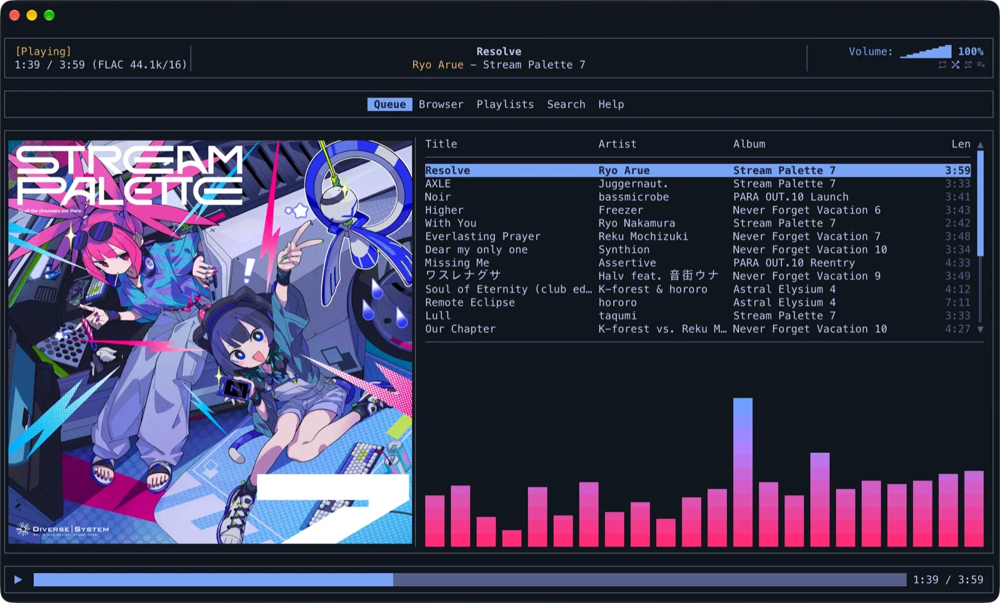
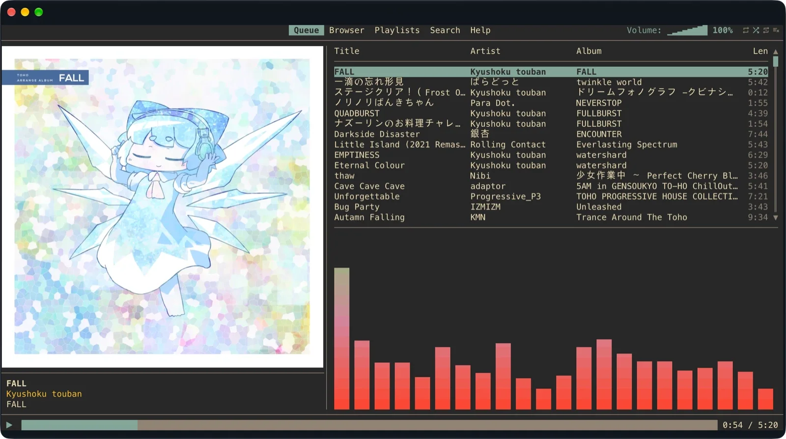

# shmc

A terminal music player for Plex, written in Rust and built with [Ratatui](https://ratatui.rs/). Inspired by [rmpc](https://github.com/mierak/rmpc). Not affiliated with or endorsed by Plex Inc.

- Browse, search and play your Plex music library through mpv.
- Album art, a cava visualizer and themes.
- Radio, stations and sonically similar music with Plex Pass.

See [Features](#features) for details.

## Preview

[](docs/images/queue.webp)

[](docs/images/browser.webp)

Compact layout with the `gruvbox-dark` theme and track details below the cover:

[](docs/images/compact.webp)

## Features

### Library
- Browse artists, albums, tracks and playlists.
- Search and filter your library.
- Play now, play next or add to the queue; select ranges and jump by letter.

### Queue and playback
- Gapless playback through mpv.
- Shuffle, repeat, single-track repeat and consume modes.
- Reorder tracks, undo removals and save queues as Plex playlists.
- Sleep timer and automatic skipping of failed tracks.

### Plex
- View track ratings and optionally update them on Plex.
- Optionally report playback to Plex, including play counts and last played dates.

### Radio and sonic analysis (Plex Pass)
- Track and artist radio that keeps going as you listen.
- The library's radio stations in a Discover tab.
- Sonically similar tracks, albums and artists.
- Sonic Adventure: a path of similar-sounding tracks through stops you pick.

### Appearance
- Album art via Kitty, iTerm2, Sixel or half-blocks.
- Optional cava visualizer.
- Built-in themes, with support for custom themes.
- Full and compact header layouts, configurable queue columns and Nerd Font or ASCII icons.

### Configuration
- Run `shmc config` to edit settings, preview themes and check your setup.
- Key bindings are configurable.

### Platform support
- macOS: media keys, Control Center controls and Now Playing with album art.
- Linux: MPRIS and media keys aren't supported yet.

## Requirements

- Plex Media Server with a music library.
- [mpv](https://mpv.io) 0.36 or newer. Some older distributions ship an earlier version.
- [cava](https://github.com/karlstav/cava) (optional, for the visualizer).
- A terminal supporting at least 256 colours.
- A [Nerd Font](https://www.nerdfonts.com) for the default icons. Set `ui.icons = "ascii"` to use ASCII icons instead.
- [Rust](https://rustup.rs) 1.88 or newer, git and a C compiler (for building from source).

## Install

Install mpv and cava:

```sh
# macOS
brew install mpv cava

# Debian / Ubuntu
sudo apt install mpv cava

# Fedora
sudo dnf install mpv cava
```

Run the installer:

```sh
curl -fsSL https://raw.githubusercontent.com/gabagool-goblin/shmc/main/scripts/install.sh | sh
```

The installer downloads a prebuilt binary for macOS on Apple Silicon or Linux on x86_64 and arm64. Downloads are verified against the release's `SHA256SUMS` file. To check that a downloaded tarball was built by this repository's release workflow, run `gh attestation verify shmc-*.tar.gz --repo gabagool-goblin/shmc`.

On other platforms, or when using `--source`, the installer builds from source. This requires Rust 1.88 or newer, git and a C compiler. On macOS, install the compiler tools with `xcode-select --install`. On Debian or Ubuntu, install `build-essential`; on Fedora, install `gcc`.

The default install location is `~/.local/bin`. Set a different location with `install.sh DIR` or `PREFIX=DIR`. Use `--version x.x.x` to install a specific release. Pass options through the pipe with `sh -s --`:

```sh
curl -fsSL https://raw.githubusercontent.com/gabagool-goblin/shmc/main/scripts/install.sh | sh -s -- --version 0.1.0
```

From an existing checkout, the installer builds the local source:

```sh
git clone https://github.com/gabagool-goblin/shmc
cd shmc
./scripts/install.sh
```

Alternatively, install with Cargo:

```sh
cargo install --locked --git https://github.com/gabagool-goblin/shmc
```

## Getting started

Run `shmc`. On first launch, enter your Plex server URL and token. Settings are saved to `~/.config/shmc/config.toml`.

See [Configuration](docs/configuration.md) for help finding your token.

| Key | Action |
|---|---|
| `1`–`6`, `Tab` | Switch tabs |
| `h` `j` `k` `l` / arrows | Navigate |
| `Enter` | Play selection |
| `a` / `i` | Add to queue / play next |
| `Space` | Pause / resume |
| `>` / `<` | Next / previous |
| `/` | Filter |
| `?` | All key bindings |
| `q` | Quit |

Run `shmc config` to edit settings and check your setup. Use `shmc config --check` to run checks without opening the editor.

## Documentation

- [Configuration](docs/configuration.md)
- [Keys and commands](docs/keys.md)
- [Themes](docs/themes.md)
- [Troubleshooting](docs/troubleshooting.md)
- [Changelog](CHANGELOG.md)
- [Contributing](CONTRIBUTING.md)

## Credits

shmc's layout is based on the preview screenshot from [rmpc](https://github.com/mierak/rmpc), but the code is an independent implementation. Theme credits are listed in [themes.md](docs/themes.md).

## License

BSD 3-Clause. See [LICENSE](LICENSE).

## AI disclosure

AI tools were used during development for code, documentation and debugging. Changes are reviewed and tested before merging. The project comes with no warranty; use it at your own risk.
